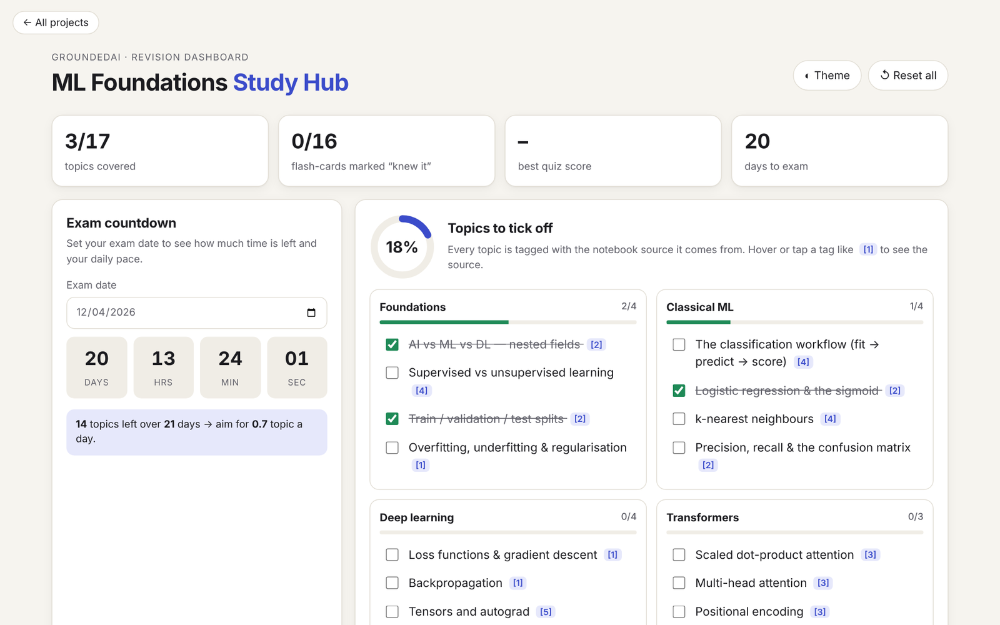
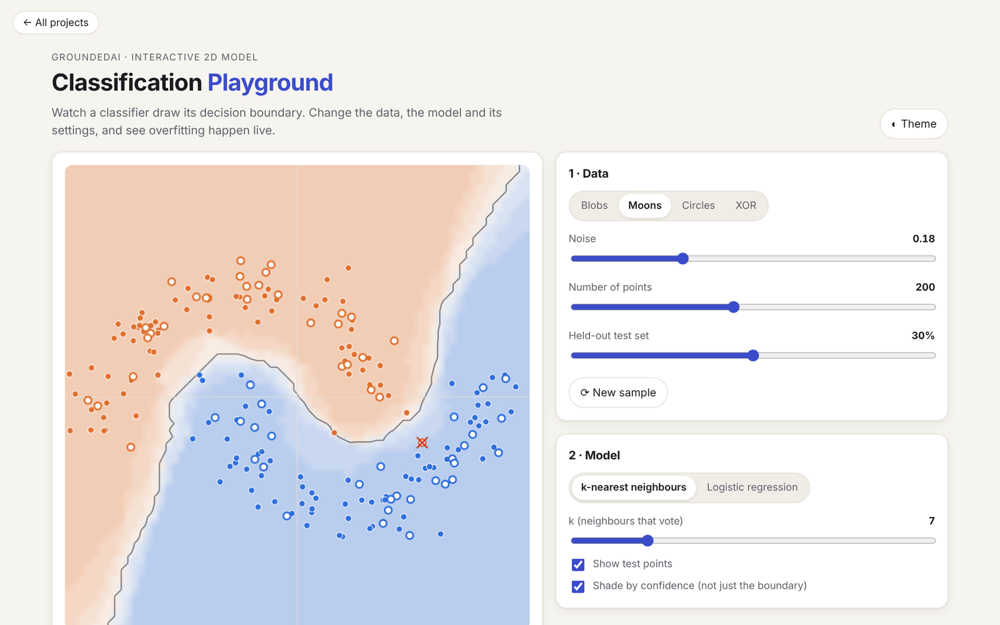

# GroundedAI Tools

Three interactive machine-learning tools built from my **GroundedAI** notebook, a source-grounded study assistant over 8 ML references. Each tool is a single HTML file, made with an AI agent without writing code by hand.

**BSERC GenAI Internship · Week 1 · Project 2 ("Thinking in HTML")**

**▶ Live demo:** https://pranavthatenough.github.io/groundedai-tools/

**📓 Source notebook (Project 1):** [GroundedAI notebook](https://notebook.google.com/notebook/c8a75025-8605-4f81-aba1-88c6b47f8669). Everything in these tools is grounded in this notebook and its sources.


## The tools

### 1. ML Foundations Study Hub (revision dashboard)
A revision hub for AI vs ML vs DL, supervised and unsupervised learning, classical ML, deep learning, Transformers and grounded AI.

- Tick off 17 topics, with a progress ring and per-topic bars
- Exam countdown with a daily study pace
- 16 flip-cards with topic filter, search, shuffle and "knew it / review again" marks
- Scored 10-question quiz with explanations and a review screen
- Every item is tagged with the notebook source it comes from, e.g. **[3]** = *Attention Is All You Need*
- Dark mode; progress is saved in the browser



### 2. Classification Playground (interactive 2D model)
Watch a classifier draw its decision boundary live, and see overfitting happen.

- 4 datasets (blobs, moons, circles, XOR) with noise, size and test-split sliders
- **k-nearest neighbours** (k slider) and **logistic regression** (linear or polynomial features, learning rate, animated gradient descent with a loss curve)
- Train vs test accuracy, precision, recall and a confusion matrix
- A live message that says whether the model is overfitting, underfitting or generalising well
- Click the plot to add your own points



### 3. Grounded Answer Lab (my own idea)
Shows *why* source-grounded AI is more trustworthy than a chatbot answering from memory.

- Ask an ML question. A small retriever ranks passages from the notebook's sources.
- The grounded assistant answers **only** from those passages, with clickable **[1] [2]** citations that jump to the evidence.
- It says **"Not in my sources"** for off-topic questions (e.g. ResNet tuning, the FIFA World Cup) instead of guessing.
- Next to it, a simulated memory-only chatbot gives confident answers with planted mistakes; **Spot the problems** reveals them.
- Switch sources on and off, change top-k and the relevance threshold, and watch the answers change.


## Run it

- **Online:** open the live demo link above.
- **Offline:** download the repo (*Code → Download ZIP*), unzip, and double-click `index.html` or any of the three tool files. No install and no internet needed.

Works on a laptop or a phone.

## Notebook sources

All three tools are built on my Project 1 notebook, **[GroundedAI](https://notebook.google.com/notebook/c8a75025-8605-4f81-aba1-88c6b47f8669)**. It answers only from the references below and cites every claim.

1. Dive into Deep Learning (D2L)
2. Google Machine Learning Crash Course
3. *Attention Is All You Need* (Vaswani et al., 2017)
4. scikit-learn documentation
5. PyTorch tutorials
6. My own GroundedAI notes

The Answer Lab's passages are my own short summaries of these sources, not copied text.

## How it was built

- **Agent:** Claude, prompted with the 4-part format from the brief: *who* it's for, *what* it is, what it should *do*, and the *rules*.
- **Rules for every page:** a single HTML file, no internet needed, works on a phone, at least 5 interactive controls, facts must match the sources.
- **Testing:** every control was clicked in a headless browser at laptop and phone sizes, then 5 fix rounds were run on what broke. Example: the Answer Lab answered an off-topic ResNet question from a general passage, so a "gap check" was added to refuse it.

The full prompts and every fix round are in [`prompts.md`](prompts.md).

## Files

```
index.html                          home page with a Live demo button for each tool
1-ml-revision-dashboard.html        tool 1
2-classification-playground.html    tool 2
3-grounded-answer-lab.html          tool 3
prompts.md                          every prompt, in order, plus fix rounds
screenshots/                        images used in this README
```

## License

[MIT](LICENSE)