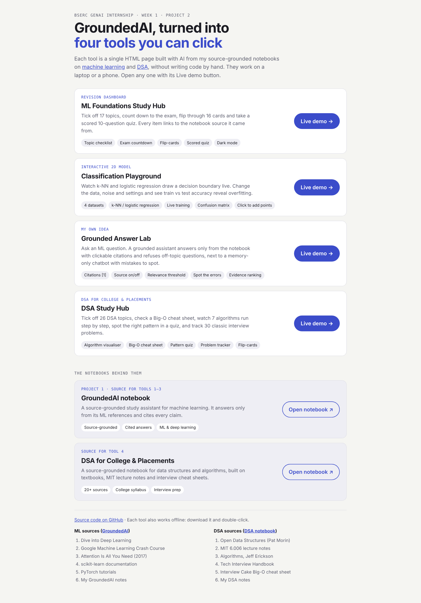
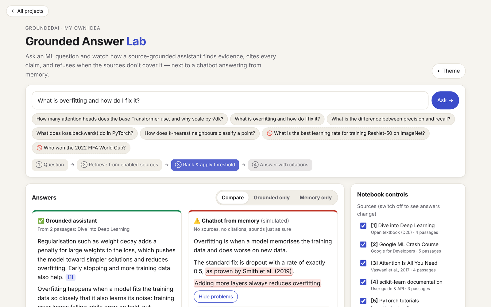
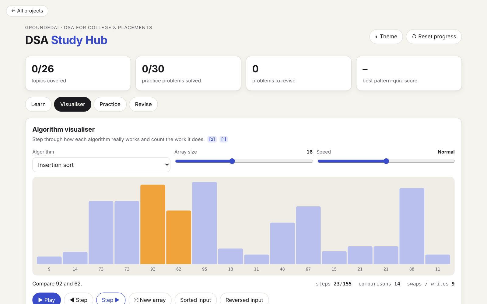

# GroundedAI Tools

Four interactive study tools built from my source-grounded notebooks: three for **machine learning** (from my GroundedAI notebook) and one for **data structures and algorithms** (from my DSA notebook). Each tool is a single HTML file, made with an AI agent without writing code by hand.

**BSERC GenAI Internship · Week 1 · Project 2 ("Thinking in HTML")**

**▶ Live demo:** https://pranavthatenough.github.io/groundedai-tools/

**📓 Source notebooks:** ML: [GroundedAI notebook](https://notebook.google.com/notebook/c8a75025-8605-4f81-aba1-88c6b47f8669). Everything in tools 1–3 is grounded in this notebook. DSA: [DSA for College & Placements](https://notebook.google.com/notebook/98f130de-72b3-40ac-baf9-5136ce1efd53), the source for tool 4.



## The tools

### 1. ML Foundations Study Hub (revision dashboard)
A revision hub for AI vs ML vs DL, supervised and unsupervised learning, classical ML, deep learning, Transformers and grounded AI.

- Tick off 17 topics, with a progress ring and per-topic bars
- Exam countdown with a daily study pace
- 16 flip-cards with topic filter, search, shuffle and "knew it / review again" marks
- Scored 10-question quiz with explanations and a review screen
- Every item is tagged with the notebook source it comes from, e.g. **[3]** = *Attention Is All You Need*
- Dark mode; progress is saved in the browser


### 2. Classification Playground (interactive 2D model)
Watch a classifier draw its decision boundary live, and see overfitting happen.

- 4 datasets (blobs, moons, circles, XOR) with noise, size and test-split sliders
- **k-nearest neighbours** (k slider) and **logistic regression** (linear or polynomial features, learning rate, animated gradient descent with a loss curve)
- Train vs test accuracy, precision, recall and a confusion matrix
- A live message that says whether the model is overfitting, underfitting or generalising well
- Click the plot to add your own points


### 3. Grounded Answer Lab (my own idea)
Shows *why* source-grounded AI is more trustworthy than a chatbot answering from memory.

- Ask an ML question. A small retriever ranks passages from the notebook's sources.
- The grounded assistant answers **only** from those passages, with clickable **[1] [2]** citations that jump to the evidence.
- It says **"Not in my sources"** for off-topic questions (e.g. ResNet tuning, the FIFA World Cup) instead of guessing.
- Next to it, a simulated memory-only chatbot gives confident answers with planted mistakes; **Spot the problems** reveals them.
- Switch sources on and off, change top-k and the relevance threshold, and watch the answers change.



### 4. DSA Study Hub (for college and placements)
A complete DSA revision and practice tool for college exams and coding interviews, grounded in my [DSA notebook](https://notebook.google.com/notebook/98f130de-72b3-40ac-baf9-5136ce1efd53).

- **Learn:** a 26-topic syllabus checklist (arrays to dynamic programming and interview patterns), each tagged with its source, plus a **Big-O cheat sheet** for data structures and sorting algorithms
- **Visualiser:** watch bubble, selection, insertion, merge and quick sort, plus binary and linear search, step by step. It counts comparisons and swaps, and you can try sorted or reversed input to see best and worst cases.
- **Practice:** a **"Which pattern?" quiz** (two pointers, sliding window, BFS, DP…) and a **tracker** for 30 classic interview problems (Todo → Solved → Revise)
- **Revise:** 18 flip-cards on complexities, trade-offs and interview tips
- Progress is saved in the browser; dark mode



## Run it

- **Online:** open the live demo link above.
- **Offline:** download the repo (*Code → Download ZIP*), unzip, and double-click `index.html` or any of the four tool files. No install and no internet needed.

Works on a laptop or a phone.

## Notebook sources

**ML: [GroundedAI notebook](https://notebook.google.com/notebook/c8a75025-8605-4f81-aba1-88c6b47f8669)** (tools 1–3). It answers only from these references and cites every claim.

1. Dive into Deep Learning (D2L)
2. Google Machine Learning Crash Course
3. *Attention Is All You Need* (Vaswani et al., 2017)
4. scikit-learn documentation
5. PyTorch tutorials
6. My own GroundedAI notes

The Answer Lab's passages are my own short summaries of these sources, not copied text.

**DSA: [DSA for College & Placements](https://notebook.google.com/notebook/98f130de-72b3-40ac-baf9-5136ce1efd53)** (tool 4)

1. [Open Data Structures](https://opendatastructures.org/), Pat Morin (free textbook)
2. [MIT 6.006 Introduction to Algorithms](https://ocw.mit.edu/courses/6-006-introduction-to-algorithms-spring-2020/pages/lecture-notes/), lecture notes
3. [Algorithms](https://jeffe.cs.illinois.edu/teaching/algorithms/), Jeff Erickson: dynamic programming and greedy chapters
4. [Tech Interview Handbook](https://www.techinterviewhandbook.org/algorithms/introduction/): topic cheat sheets
5. [Big-O Cheat Sheet](https://www.interviewcake.com/big-o-cheatsheet), Interview Cake
6. My own DSA notes

## How it was built

- **Agent:** Claude, prompted with the 4-part format from the brief: *who* it's for, *what* it is, what it should *do*, and the *rules*.
- **Rules for every page:** a single HTML file, no internet needed, works on a phone, at least 5 interactive controls, facts must match the sources.
- **Testing:** every control was clicked in a headless browser at laptop and phone sizes, then 5 fix rounds were run on what broke. Example: the Answer Lab answered an off-topic ResNet question from a general passage, so a "gap check" was added to refuse it.

The full prompts and every fix round are in [`prompts.md`](prompts.md).

## Files

```
index.html                          home page: a Live demo button for each tool and both notebooks
1-ml-revision-dashboard.html        tool 1
2-classification-playground.html    tool 2
3-grounded-answer-lab.html          tool 3
4-dsa-study-hub.html                tool 4
prompts.md                          every prompt, in order, plus fix rounds
screenshots/                        images used in this README
```

## License

[MIT](LICENSE)
